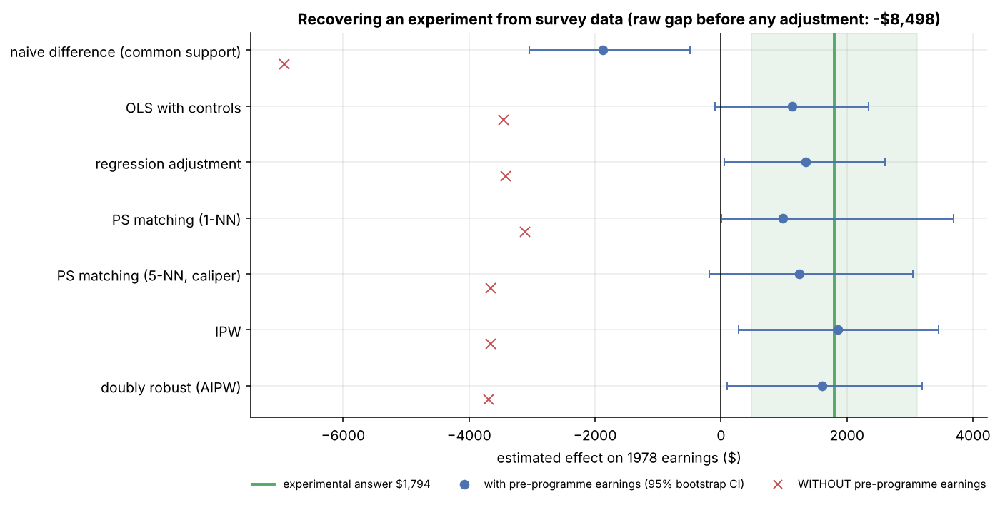
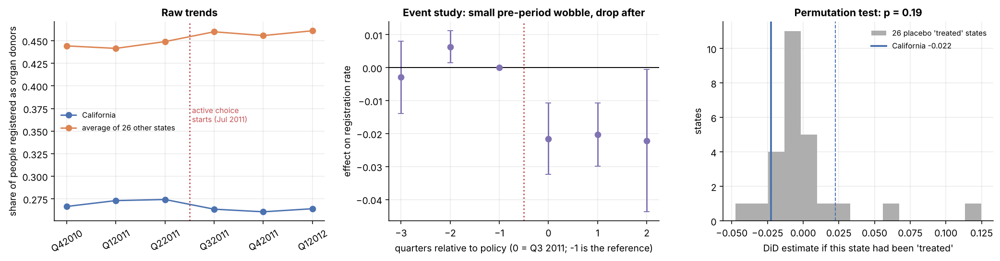
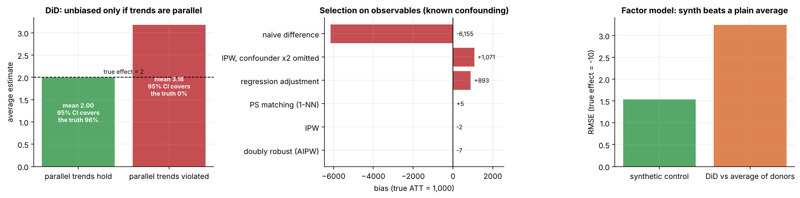

# Causal Inference Casebook

**"Did it actually work?" answered without an experiment.** Four classic policy questions, each solved with the
method that fits it (difference-in-differences, propensity-score matching and weighting, synthetic control), then
attacked with placebo tests, sensitivity analysis and simulations.


 
 

Every headline number is **replicated against a published paper or a randomised experiment**, and the test suite
fails if it drifts.

```bash
pip install -e ".[dev]"
casebook data              # download + checksum the four datasets
casebook case tobacco      # or: minwage | organ | training
casebook report            # all figures + reports/metrics.json (~5 min)
pytest                     # 20 tests: replications, estimator checks, placebos
```

---

## The four cases

| Case | Question | Method | Answer | Robustness verdict |
|---|---|---|---|---|
| 🍔 **Minimum wage** (Card & Krueger 1994) | Did NJ's $4.25 → $5.05 rise cost fast-food jobs? | 2×2 DiD vs eastern PA; regression and first-difference versions | **+2.75 FTE per store** (SE 1.31); no evidence of job losses | ✓ replicates Tables 3 & 4 exactly; same sign in 7 specifications; placebo (PA vs PA) null; wages rose $0.48 (first stage) |
| 🫀 **Organ donation** (Kessler & Roth, via *The Effect*) | Did California's "active choice" form change donor registration? | two-way FE DiD + event study | **−2.25 pp (−8%)**, clustered p < 0.001 | ⚠ only one treated state: permutation p = **0.19**; one pre-period lead nonzero. Suggestive, not conclusive |
| 💼 **Job training** (LaLonde 1986; Dehejia & Wahba 1999) | Did the NSW programme raise earnings, using survey data instead of the experiment? | propensity score: matching, IPW, doubly robust | IPW **$1,860**, AIPW **$1,607** vs experimental truth **$1,794** (raw gap: −$8,498) | ✓ all methods right sign; ✗ **drop pre-programme earnings and every method says −$3,500**; robustness value 3.1% (fragile) |
| 🚭 **Tobacco tax** (Abadie, Diamond & Hainmueller 2010) | Did California's Proposition 99 cut cigarette sales? | synthetic control (from scratch) | **−19 packs per person per year** (1989–2000); **−26 (−38%) by 2000** | ✓ ranks 1st of 39 placebo states (p = 0.026); leave-one-out −17.5 to −21; donor weights match ADH |


## What the casebook shows

**1. Methods recover the truth only when the key confounder is measured.**
NSW participants earned $8,498 *less* than survey respondents, yet the experiment shows the programme *added*
$1,794. With 1974–75 earnings in the model, IPW gets $1,860 and doubly robust $1,607. Without them, every method
confidently reports about −$3,500.



**2. Inference with one treated unit needs placebos, not textbook standard errors.**
The organ-donation DiD looks rock-solid with clustered SEs (p < 0.001) but California's drop is only the 5th
largest of 27 states when every state takes a turn as "treated" (p = 0.19). For Prop 99 the same logic gives
p = 1/39, a much stronger result.



**3. Pick the comparison that fits the data.** DiD against the average state says Prop 99 cut sales by 27 packs;
California was already declining faster, and the synthetic control, which matches its pre-1989 path
(RMSPE 1.8 packs), says 19.

**4. Validate estimators where the truth is known.** Simulations reproduce each method's textbook behaviour: DiD
is unbiased with parallel trends (95% CI coverage 96%) and badly biased without them (coverage 0%); IPW, matching
and AIPW recover a known effect within $10 while a misspecified regression is off by $893 and omitting one
confounder costs $1,071; synthetic control halves the error of DiD in a factor model.



## Methods implemented

| Module | What's in it |
|---|---|
| `did.py` | 2×2 tables with SEs, regression DiD (clustered), first differences, two-way FE, event study, permutation inference, placebo-in-time |
| `matching.py` | propensity model (Dehejia–Wahba spec), common support, NN matching with caliper, IPW, regression adjustment, doubly robust AIPW, balance (SMD), stratified bootstrap, placebo permutation, Cinelli–Hazlett robustness value |
| `synth.py` | synthetic control from scratch (NNLS simplex solver + nested V optimisation), placebo-in-space with RMSPE-ratio p-values, leave-one-out, in-time placebo, DiD comparison, `pysyncon` cross-check |
| `refute.py` | DoWhy model → identify → estimate → refute (placebo treatment, random common cause, data subsets) |
| `simulate.py` | data with known effects for each method, including the failure modes |

## Learn from it

[`docs/learn/`](docs/learn/) teaches causal inference from zero using these cases:

1. [Potential outcomes and why "did it work?" is hard](docs/learn/01_potential_outcomes.md)
2. [Difference-in-differences](docs/learn/02_difference_in_differences.md): parallel trends, event studies, one treated unit
3. [Propensity scores, matching and weighting](docs/learn/03_propensity_scores.md): overlap, balance, the omitted-variable lesson
4. [Synthetic control](docs/learn/04_synthetic_control.md): weights, placebos, why it beats an average
5. [Robustness and refutation](docs/learn/05_robustness_and_refutation.md): placebos, sensitivity, DoWhy, simulation
6. [Choosing a method and presenting it](docs/learn/06_choosing_a_method.md): decision guide + one-page answer template
7. [Interview questions](docs/learn/07_interview_questions.md)

For non-technical readers: [executive summary](docs/EXECUTIVE_SUMMARY.md).

## Repository layout

```
├── src/causalbook/   data · did · matching · synth · refute · simulate · cases · viz · report · cli
├── tests/            replications of published numbers, estimator unit tests, simulations, DoWhy cross-check
├── reports/          figures, CSV tables, metrics.json (generated by `casebook report`, committed)
├── docs/             executive summary, GitHub guide, 7 lessons
└── data/raw/         downloaded files (git-ignored, sha256-checked)
```

## Data

| Dataset | Source |
|---|---|
| Card & Krueger fast-food survey (410 stores, 1992) | David Card's `public.dat`, via a GitHub mirror (sha256-pinned) |
| Organ-donor registration (27 states × 6 quarters) | `causaldata` package (*The Effect*, Huntington-Klein) |
| NSW experiment + CPS comparison (LaLonde / Dehejia–Wahba) | `causaldata` package (*The Mixtape*, Cunningham) |
| Cigarette sales, 39 states, 1970–2000 (ADH 2010) | GitHub mirror (sha256-pinned) |

Code: MIT. Data: published research data; cite the original papers. See [LICENSE](LICENSE).

## Limitations

- These are teaching replications of well-known studies, not new policy evaluations; each has a literature of
  follow-ups (e.g. Neumark & Wascher 2000 on the minimum wage).
- The NSW/CPS subsample is known to be a favourable case for propensity methods (Smith & Todd 2005).
- Synthetic control's optimisation is non-convex; weights differ slightly between implementations (effects agree
  within ~1 pack).
- Not covered: instrumental variables, regression discontinuity, staggered-adoption DiD estimators.
