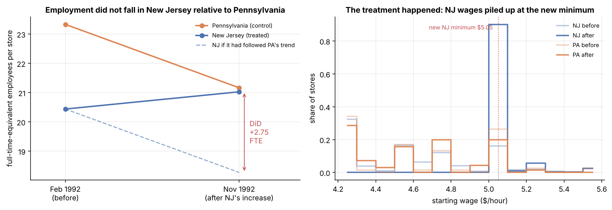
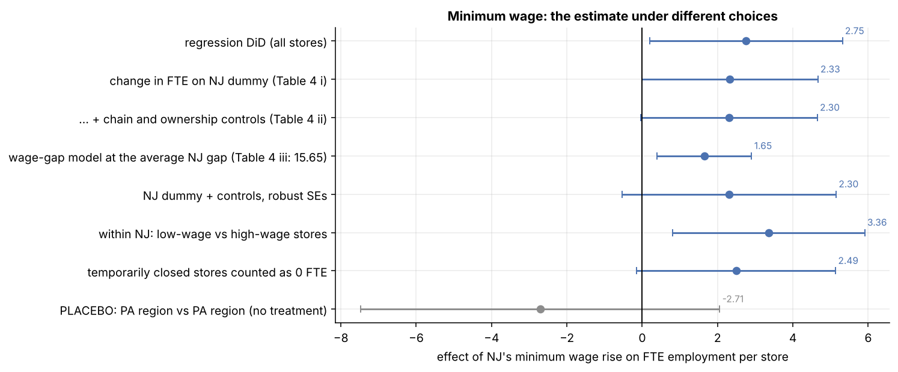

# 02 · Difference-in-differences

Code: `src/causalbook/did.py`, `cases.minimum_wage()`, `cases.organ_donation()`. Run `casebook case minwage`.

## Case A: did a minimum-wage rise cost jobs? (Card & Krueger 1994)

On 1 April 1992 New Jersey raised its minimum wage from $4.25 to $5.05. Basic economics predicted fewer jobs.
David Card and Alan Krueger surveyed 410 fast-food restaurants (Burger King, KFC, Roy Rogers, Wendy's) in New
Jersey and in eastern Pennsylvania, just across the river, where the minimum stayed at $4.25. Once in February
(before), once in November (after). Card later shared the 2021 Nobel prize partly for this kind of "natural
experiment" design.

### The 2×2 table

| FTE per store | Feb 1992 | Nov 1992 | change |
|---|---|---|---|
| Pennsylvania (control) | 23.33 | 21.17 | **−2.16** |
| New Jersey (treated) | 20.44 | 21.03 | **+0.59** |
| difference NJ − PA | −2.89 | −0.14 | **+2.75** |

(These match the paper's Table 3 to the second decimal; `tests/test_data.py` checks it.)

Two naive answers, both wrong:

- *Before vs after in NJ*: +0.59. But employment changes for many reasons (season, the 1992 economy).
- *NJ vs PA after*: −0.14. But NJ stores were smaller to begin with.

**DiD** subtracts both: NJ's change minus PA's change = 0.59 − (−2.16) = **+2.75 FTE**. PA's change estimates
what would have happened to NJ without the law: the dashed line in the figure.

### The assumption: parallel trends

DiD does **not** need the groups to look alike. It needs them to *move alike* without treatment: if NJ hadn't
raised its wage, its employment would have changed by the same amount as PA's. You can never check that for the
post-period (that's the counterfactual), so you check what you can:

- **Pre-trends.** With several pre-periods, plot them (Case B). Card & Krueger had only one pre-period, a real
  weakness.
- **Placebo groups.** Compare two groups where *nothing* happened. Two PA regions against each other:
  −2.71 FTE, CI −7.5 to +2.1: no significant "effect", as it should be. (It's noisy: only 79 PA stores.)
- **A different control group.** Inside NJ, stores already paying ≥ $5.00 were barely affected by the law.
  Low-wage NJ stores vs high-wage NJ stores: **+3.36 (SE 1.30)**, the same direction, with a control group
  that shares NJ's economy.

### Three ways to compute the same DiD

1. **Means table** (above).
2. **Regression** on the long data (two rows per store):
   `fte ~ nj + post + nj:post`, the coefficient on `nj:post` is the DiD: **2.75 (SE 1.31, clustered by store)**.
   Clustering matters because the two observations of one store are not independent.
3. **First differences** (one row per store): regress the change on the NJ dummy. With two periods this equals
   store fixed effects. On the paper's 357-store sample: **2.33 (1.19)**, exactly Table 4 column (i).

The regression versions let you add controls (chain, ownership: 2.30) and use a **treatment intensity** instead
of a dummy: the "wage gap" (how much a store's starting wage had to rise). Coefficient 15.65 (6.08), again
matching the paper; at the average NJ gap that is +1.65 FTE. A dose-response check: stores that had to raise
wages more did not lose more jobs.

### Did the treatment actually happen? ("first stage")

Starting wages rose **$0.48** more in NJ than in PA (SE 0.05). The right panel of the first figure shows NJ wages
piling up at the new $5.05. Always check the treatment changed what it was supposed to change before reading the
outcome.

Meal prices rose about $0.08 (≈ 2.4%) more in NJ (p = 0.09): consistent with restaurants passing on costs
rather than cutting staff.

### What we can and can't conclude

Every estimate is positive and the lower ends of the CIs are near zero or slightly below (with robust SEs, the
lowest is −0.54 FTE, about −2.6% of a store's staff). The data **rule out large job losses**; they don't prove
employment rose. This study started a long debate: Neumark & Wascher (2000) found negative effects using payroll
records; Card & Krueger (2000) replied with official employment data showing small or no effects. One study is
one study.

## Case B: more periods, one treated unit (organ donation)

In July 2011 California changed the driver's licence form: instead of an opt-in box, people had to actively
answer "do you want to be an organ donor?" ("active choice"). Data: share of people registered as donors, 27
states, 6 quarters (Q4 2010 – Q1 2012), from Kessler & Roth via *The Effect* (Huntington-Klein).

**Two-way fixed effects** (state fixed effects + quarter fixed effects + a treated-now dummy): **−0.0225**
(−2.25 percentage points, −8% of California's 27% baseline). Clustered SE 0.0067, p < 0.001.

### Event study: checking pre-trends

Replace the single dummy with one dummy per quarter (California × quarter), relative to the last pre-period:

| quarters relative to policy | −3 | −2 | −1 | 0 | +1 | +2 |
|---|---|---|---|---|---|---|
| coefficient | −0.003 | +0.006 | 0 (ref) | −0.022 | −0.020 | −0.022 |

Leads (before the policy) should be near zero if trends were parallel: they are small (one is +0.006,
nominally significant, a warning sign worth mentioning). Lags show an immediate, stable drop.

### The catch: one treated state

Clustered standard errors assume *many* treated clusters. Here there is **one** (California), and clustered SEs
can be wildly over-confident. The honest alternative is **randomisation (permutation) inference**: pretend each
of the other 26 states was the treated one and compute the same DiD. If California's effect were real and unusual,
it should be more extreme than nearly all of the placebo effects.

California ranks **5th of 27**: permutation **p = 0.19**. Several untreated states moved as much over the same
quarters. So: the point estimate suggests active choice *lowered* registrations, but the evidence is weak. That is
a very different conclusion from "p < 0.001", and the kind of thing interviewers love.

A placebo in time (pretend the policy started one quarter earlier, using only pre-policy data) gives −0.002
(p = 0.63): nothing.

## When DiD breaks

- **Non-parallel trends** (e.g. treated regions were already on a different path). The simulation in
  `simulate.check_did` adds a small extra trend to treated units: the estimate is 3.18 instead of the true 2.0,
  and the 95% CI covers the truth 0% of the time.
- **Staggered adoption** (units treated at different times) with effects that change over time: plain TWFE can
  give badly weighted, even wrong-signed answers (Goodman-Bacon 2021). Use Callaway & Sant'Anna (2021),
  Sun & Abraham (2021) or similar estimators. Both cases here have a single treatment date, so TWFE is fine.
- **Anticipation** (people react before the official date) and **spillovers** (the control group is affected,
  e.g. PA workers commuting to NJ).
- **Composition change**: if the treated sample changes (stores closing), compare like with like (balanced panel)
  or count closures as zero (we did: 2.49).

## Business translation

"We changed the price / UI / policy in some regions and not others": that's DiD. Before trusting it: plot
pre-trends; pick control regions that move with the treated ones; check the treatment took effect; run a
placebo; and if you have very few treated regions, use permutation inference rather than regression SEs.

Next: [03 · Propensity scores, matching and weighting](03_propensity_scores.md)
