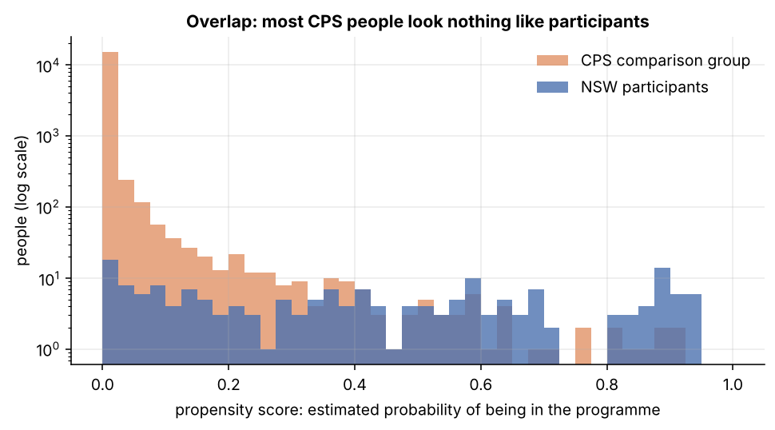
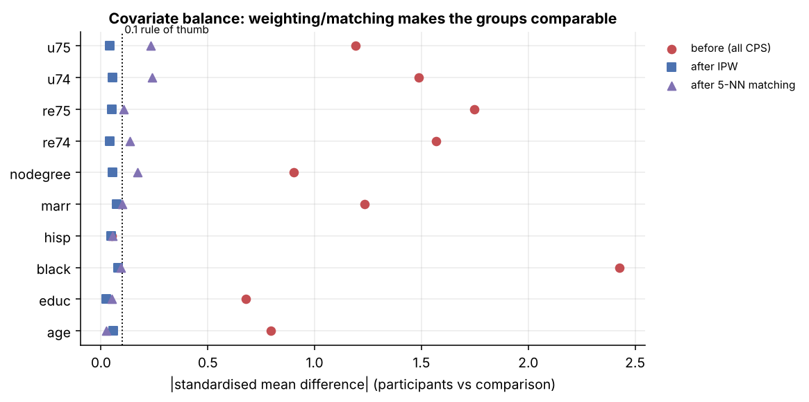

# 03 · Propensity scores, matching and weighting

Code: `src/causalbook/matching.py`, `cases.job_training()`. Run `casebook case training`.

## The setup (LaLonde's challenge)

Treated: 185 NSW participants. Comparison: 15,992 CPS men. We *know* the right answer from the experiment:
**+$1,794**. Can we recover it from the survey data alone?

The groups are very different. Participants averaged $2,096 earnings in 1974 vs $14,017 for CPS men; 84% vs 7%
were Black; 19% vs 71% were married. Before adjustment the standardised mean difference (SMD) reaches **2.4**
(anything above 0.1 counts as imbalanced).

## The assumption: no unmeasured confounders

If, among people with the same observed characteristics X (age, education, race, marital status, degree, 1974–75
earnings and unemployment), joining NSW was as good as random, then comparing treated and untreated people *with
the same X* gives the effect. Formally: Y(0) is independent of D given X ("unconfoundedness", "selection on
observables"). Plus **overlap**: for every kind of treated person, there are comparable untreated people.

Nothing in the data can confirm the first assumption. Keep that in mind for the end of this lesson.

## The propensity score

Matching on 10 variables at once is hard (the curse of dimensionality). Rosenbaum & Rubin (1983) showed it is
enough to match on one number: the **propensity score**, e(X) = P(D = 1 | X), the probability of being treated
given the covariates. Here a logistic regression with Dehejia & Wahba's specification (squares and cubes of age,
education × 1974 earnings, unemployment dummies).

### Step 1: overlap

Most CPS men have a score near 0: they look nothing like participants. They carry no information about the
participants' counterfactual, so we keep only controls inside the treated range (**common support**): 3,856
controls + 185 treated remain out of 16,177. Even the naive difference shrinks from −$8,498 to −$1,881.

### Step 2: estimate, several ways

| Method | Idea | ATT | 95% bootstrap CI |
|---|---|---|---|
| naive (common support) | difference in means | −$1,881 | −3,050 to −488 |
| OLS with controls | Y ~ D + X | $1,132 | −90 to 2,342 |
| regression adjustment | model Y(0) from controls, predict for treated | $1,341 | 53 to 2,606 |
| PS matching, 1 nearest neighbour | each participant vs the most similar control | $984 | 5 to 3,696 |
| PS matching, 5 neighbours + caliper | average of 5 close controls | $1,246 | −190 to 3,045 |
| **IPW** | weight controls by e/(1−e) | **$1,860** | 278 to 3,456 |
| **doubly robust (AIPW)** | regression + IPW correction | **$1,607** | 102 to 3,196 |
| *experiment (truth)* | | *$1,794* | *479 to 3,109* |

Every adjusted method gets the sign right and lands within ~$800 of the experiment. IPW and AIPW come closest.
The spread between methods ($984 to $1,860) is itself information: with observational data, the answer depends on
modelling choices, so report several.

**How each works:**

- **Matching** pairs each treated person with the control(s) with the closest score. Simple and easy to explain;
  throws away most controls (5-NN used 353) and the bootstrap is not strictly valid for it (Abadie & Imbens
  2008), so its CIs are approximate.
- **IPW** (inverse probability weighting) keeps everyone, but a control with score e counts e/(1−e) times:
  controls who *look like* participants get big weights; unlike ones nearly vanish. Weighted controls are a
  stand-in population that resembles the treated. Sensitive to extreme weights (scores near 1).
- **Doubly robust (AIPW)** fits both an outcome model and a propensity model. It is consistent if *either* is
  right. The simulation shows this: with a deliberately wrong outcome model, regression adjustment is off by
  +$893, while AIPW (with the right propensity model) is off by −$7.

### Step 3: check balance (the real test of the propensity model)

A propensity model is good if it **balances covariates**, not if it predicts treatment well. After IPW every
|SMD| is below 0.08; after 5-NN matching some are still 0.17–0.24 (unemployment dummies), which is one reason
matching is further from the truth here.

## The most important result: drop one variable

Re-run everything **without pre-programme earnings** (re74, re75, u74, u75), as if the survey hadn't asked:

| Method | with earnings history | without |
|---|---|---|
| IPW | $1,860 | **−$3,654** |
| AIPW | $1,607 | **−$3,693** |
| PS matching | $984 | **−$3,112** |

Every method now says the programme **cuts** earnings by about $3,500, with tight confidence intervals. The
methods didn't change; one confounder went missing. Past earnings drive both who joins and future earnings.
**No estimator can fix a confounder you didn't measure.** The real work in observational causal inference is
arguing that you have the important confounders, not choosing between IPW and matching.

## How fragile is the estimate? (sensitivity analysis)

Cinelli & Hazlett (2020) ask: how strong would an unmeasured confounder have to be to erase the effect? For the
regression estimate ($1,132, t = 2.0), the **robustness value is 3.1%**: a confounder explaining 3.1% of the
residual variance of both treatment and earnings would drive the estimate to zero. For comparison, 1975 earnings
alone explains 4.4% of the outcome's residual variance. So a hidden confounder somewhat weaker than past earnings
could overturn the regression result. That is an honest statement of fragility, and much more useful to a
decision-maker than a p-value.

## Placebo: shuffle the treatment

Shuffle who was "treated" 300 times and re-run the whole IPW pipeline. Placebo effects centre on $0 (SD $503); the
real $1,860 is beyond all 300 (p < 0.003). The pipeline doesn't manufacture effects from nothing.

## A caveat about this benchmark

The Dehejia–Wahba subsample (participants with 1974 earnings data) is known to be an "easy" case; on LaLonde's
original sample and other comparison groups, propensity methods do worse (Smith & Todd 2005). The general lesson
is the one above: results depend far more on which covariates you have than on the estimator.

## Business translation

"Customers who joined the loyalty programme spend 40% more": joiners were already your best customers. Before
claiming an effect: measure pre-period behaviour (the "re74/re75" of your problem: past spend, tenure,
engagement), restrict to overlap, check balance, report several estimators, and run a sensitivity analysis.
If the stakes are high, run an experiment (e.g. randomised invitations).

Next: [04 · Synthetic control](04_synthetic_control.md)
