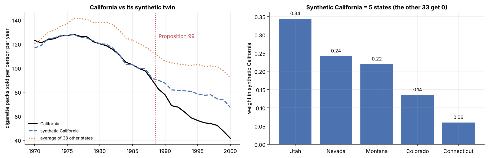
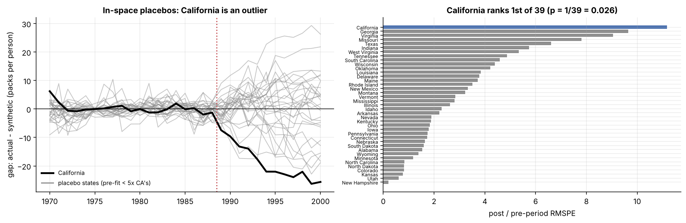
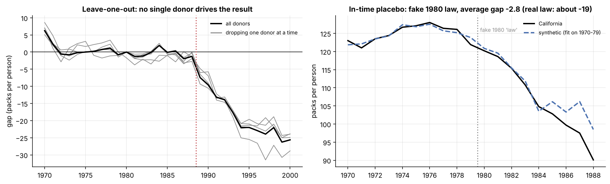

# 04 · Synthetic control

Code: `src/causalbook/synth.py` (from scratch), `cases.tobacco()`. Run `casebook case tobacco`.

## The question

In November 1988 California passed **Proposition 99**: a 25-cent tax per pack and a large anti-smoking programme
funded by it. Did cigarette sales fall *because* of it? Sales were already falling everywhere in the US.

One treated unit, 38 possible controls (states without big tobacco programmes in the period), 19 years before
and 12 after. Classic synthetic-control territory (Abadie, Diamond & Hainmueller 2010, "ADH").

## Why not DiD against the average state?

California's sales were falling *faster* than the average state's even before 1988 (dotted line in the figure),
so parallel trends fails. DiD against the average gives −27 packs per person per year, but part of that is the
pre-existing faster decline.

## The idea: build a twin

Find weights W (non-negative, summing to 1) on the 38 donor states so the weighted average matches California
*before* 1989, on sales and on predictors of sales (income, cigarette price, share of young people, beer
consumption). After 1989 the weighted average, "synthetic California", is the counterfactual.

| Donor | weight (ours) | weight (ADH 2010) |
|---|---|---|
| Utah | 0.344 | 0.334 |
| Nevada | 0.242 | 0.234 |
| Montana | 0.220 | 0.199 |
| Colorado | 0.135 | 0.164 |
| Connecticut | 0.059 | 0.069 |
| other 33 states | 0 | 0 |

Synthetic California tracks the real one closely from 1970 to 1988 (root mean squared prediction error, RMSPE,
**1.78 packs**), then the lines separate. **Estimated effect: −18.9 packs per person per year on average over
1989–2000, −25.6 by 2000**, about 38% below the synthetic counterfactual.

### How the weights are chosen (the nested optimisation)

1. **Inner problem.** For given importance weights V on the predictors, choose W to minimise the V-weighted
   distance between California's predictors and the donors' weighted predictors, with W ≥ 0 and ΣW = 1.
   (`simplex_weights`: non-negative least squares with the sum-to-one constraint added as a heavily weighted
   equation; verified against SciPy's SLSQP in the tests.)
2. **Outer problem.** Choose V so that the resulting W gives the best fit of *pre-1989 sales*. Predictors that
   help predict sales get more importance. (`fit`: Nelder–Mead on a softmax of V, several random starts.)

The outer problem is **not convex**: different optimisers can stop at different solutions. Cross-check with the
independent `pysyncon` package (in `reports/metrics.json`):

| Solution | pre-RMSPE | effect 1989–2000 |
|---|---|---|
| ours (4 starts) | **1.78** | −18.9 |
| pysyncon, regression start | 1.98 | −17.8 |
| pysyncon, equal-weights start | 4.63 (local optimum) | −19.8 |

Weights differ, effects don't much. Lesson: report the pre-period fit, try several starts, and don't over-interpret
individual weights.

Why non-negative weights that sum to 1? They keep synthetic California an **interpolation** of real states (no
extrapolation, no "minus half of Texas"), and the weights are transparent: you can ask a domain expert whether
Utah, Nevada and Montana are sensible comparisons.

## Inference: there is no standard error, so use placebos

With one treated unit, sampling-based SEs don't apply. ADH's answer is **placebo-in-space**: pretend each donor
state passed Prop 99 in 1989, build its synthetic twin, and see how big its "effect" is.

Compare states using the **ratio of post-period to pre-period RMSPE** (a big gap that wasn't there before).
California's ratio (11.2) is the largest of all 39: **permutation p = 1/39 = 0.026**. Dropping placebos with a
much worse pre-fit than California (they can't be compared fairly): p = 0.029 (< 20× California's pre-MSPE),
0.034 (< 5×), 0.059 (< 2×). ADH report 1/39 = 0.026 for all placebos and 1/19 = 0.05 with the 2× cutoff; small
differences in which placebos pass the cutoff come from the optimiser.

## More robustness checks

- **Leave-one-out**: drop each donor with positive weight and refit. Effect stays between −17.5 and −21.0.
  No single state drives the result.
- **In-time placebo**: pretend the law passed in 1980, fit on 1970–79 only. Average "effect" 1980–88: −2.8 packs
  (vs −18.9 for the real law). Small, though not zero: the fake twin drifts a little in the mid-1980s, a reminder
  that fit quality degrades with fewer pre-years.

## When synthetic control works (and when it doesn't)

Works when: a long pre-period, a treated unit that lies *inside* the range of donors (California's 1988 sales of
90 packs are within the donors' range), donors not affected by the treatment (no spillovers), and no other big
shock hits only the treated unit after treatment.

Fails when: the treated unit is extreme (the biggest or smallest; no convex combination can match it), the
pre-period is short or noisy, or donors were also treated.

The simulation (`simulate.check_synth`, a factor model where units respond differently to common shocks) shows
the advantage: RMSE **1.54** for synthetic control vs **3.25** for DiD against the donor average.

## Business translation

This is the standard tool for **"we launched in one market"** questions: a campaign in one city, a new feature in
one country, a store format in one region. Tech companies use the same idea in geo-experiments and in Google's
CausalImpact (a Bayesian time-series cousin). Checklist: long pre-period, a clean donor pool, report the
pre-fit, run placebos in space and time, and leave-one-out.

Next: [05 · Robustness and refutation](05_robustness_and_refutation.md)
